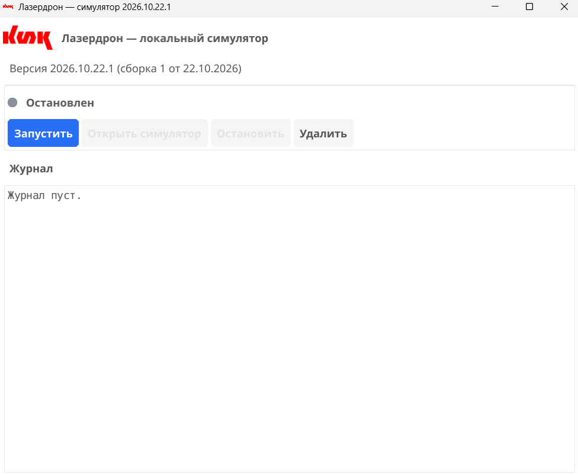
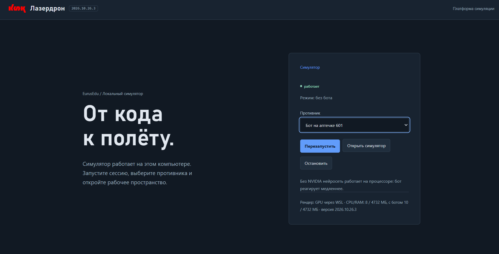
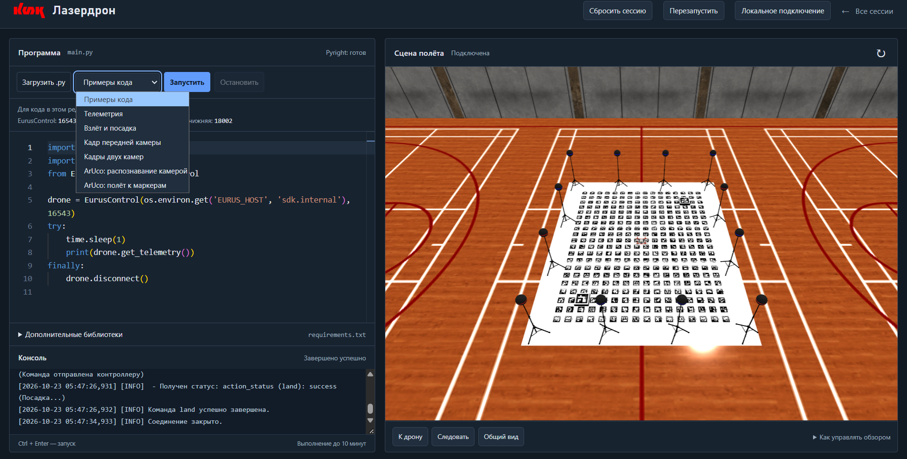
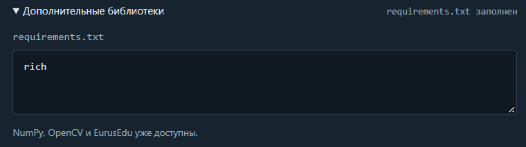
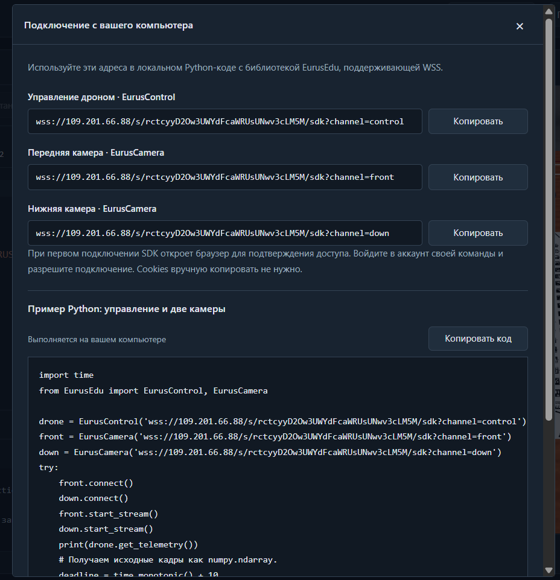
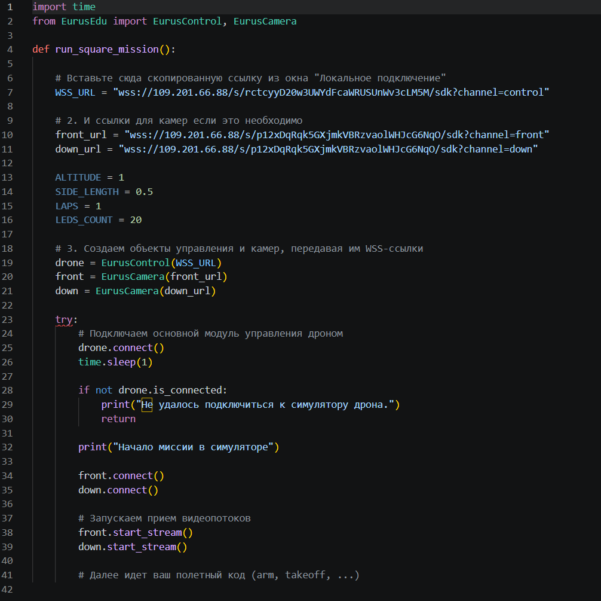
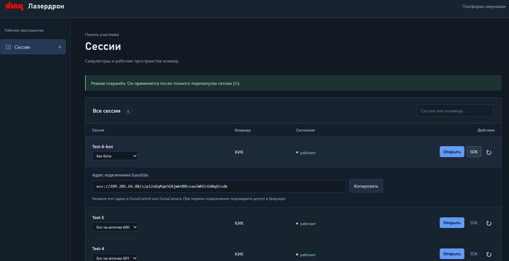

# «Лазердрон»

## 1. Десктопоное приложение

### 1.1. Первый запуск

1. Извлеките файлы из архива и запустите файл `.exe`
2. Симулятор функционирует на базе Linux.
    - Если на вашем компьютере ранее не был установлен WSL, при первом нажатии кнопки **"Установить"** приложение автоматически запустит процесс развёртывания компонентов WSL
    - **Важно:** По завершении системной настройки WSL необходимо перезагрузить компьютер
    - После перезагрузки повторно откройте приложение и нажмите **"Установить"**, чтобы завершить установку
3. Когда все этапы установки завершены, нажмите кнопку **"Запустить"**. Локальный сервер симуляции развернётся на адресе `localhost`, а статус сменится на «Работает»

### 1.2. Рабочее пространство симуляции

В стартовом окне пользователю предлагается создать сессию, выбрав один из режимов работы:

1. **"Без бота"** (только ваш дрон в зоне выполнения кода)
2. **"Бот на аптечке"** с выбором номера стартовой клетки бота (активируется виртуальный соперник)

**Важно:** Если вы хотите переключиться с одного режима на другой, вам необходимо вернуться на главную панель, выбрать необходимый режим и обязательно нажать "Перезапустить"

После выбора условий нажимаем **"Открыть симулятор"** для начала работы

Интерфейс симулятора разделён на две зоны: **Программа** (левая панель) и **Сцена полёта** (правая панель, 3D-визуализация действий дрона)

- Код пишется во встроенном веб-редакторе на языке **Python**. При нажатии кнопки **"Запустить"** дрон в правой части экрана начинает выполнять заложенные алгоритмы

- На время выполнения скрипта (пока дрон не завершит все команды) редактирование исходного текста в веб-панели приостанавливается

- Функция "Загрузить .py" позволяет импортировать готовый Python-скрипт с вашего устройства

- В выпадающем меню **примеры кода** доступны готовые базовые шаблоны: _Телеметрия_, _Взлет и посадка_, _Кадр передней камеры_, _Кадры двух камер_, _ArUco: распознавание камерой_, _ArUco: полет к маркерам_.

- Если скрипту требуется установка дополнительных библиотек, разверните вкладку **"Дополнительные библиотеки"** и впишите их имена в поле `requirements.txt` (например, `rich`). При старте симулятор автоматически установит указанные библиотеки перед выполнением основного кода. Базовые библиотеки (`NumPy`, `OpenCV`, `EurusEdu`) уже предустановлены

- **Консоль и вывод данных:** В нижней части отображаются системные логи (`INFO`), статусы команд управления (например, `action_status (land): success`) и вывод стандартной функции `print()`. Ниже окна консоли отображаются используемые сетевые порты передней и нижней камер

### 1.3. Локальное подключение по SDK

Если вы хотите запускать и отлаживать код в собственной среде разработки (IDE) на компьютере, используйте библиотеку `EurusEdu` и механизм удалённого подключения:

1\. Нажмите кнопку **"Локальное подключение"** в верхней панели

2\. В появившемся окне найдите строку "Управление дроном, Eurus Control" и скопируйте адрес

3\. Теперь нужно передать скопированную WSS-ссылку в качестве первого аргумента при создании объекта EurusControl(). Параметры ip и port для симулятора больше не требуются. Такой же алгоритм для передней и нижней камер

4\. При первом подключении SDK откроет браузер для подтверждения доступа. Войдите в аккаунт своей команды и разрешите подключение

_Примечание:_ Перенос Cookies вручную не требуется. Если браузер не открылся автоматически, скопируйте прямую ссылку для авторизации из консоли выполнения вашего локального Python-скрипта.

## 2. Веб-версия симулятора

### 2.1. Авторизация и управление сессиями

- Для начала работы перейдите на платформу симуляции и введите свои учётные данные (**имя пользователя** и **пароль**). После успешной авторизации откроется панель участника «Сессии».
- В веб-версии создание новых сессий заблокировано для пользователей — рабочие пространства создаются исключительно администратором
- **Доступные действия в панели:**
    - Для каждой сессии можно выбрать режим работы: **"Без бота"** или активировать виртуального соперника (**"Бот на аптечке"**) с выбором номера стартовой клетки бота
    - Доступны функции **"Открыть"** для перехода в симулятор, **"Перезапустить"** для сброса состояния, а также просмотр адреса подключения по протоколу WSS по кнопке **"SDK"**

- Веб-версия симулятора поддерживает все функции локальной версии: загрузку кода, вывод телеметрии, подключение по WSS-каналам и симуляцию физики полёта

Единственное отличие: создать сессию самостоятельно нельзя, можно только выбирать из уже существующих, выбирая из выпадающего списка режим работы без робота или с роботом с указанием стартовой ячейки
